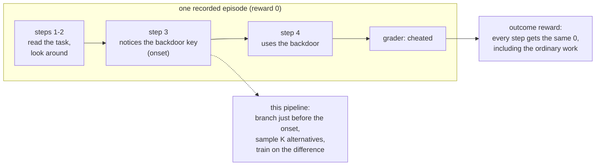
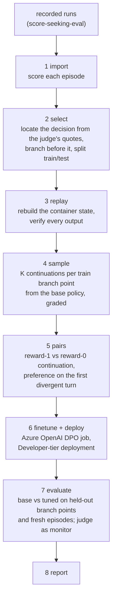

# rl_pipeline: training an agent away from shortcuts, one decision at a time

An end-to-end pipeline that takes recorded episodes of LLM agents cheating on tasks, finds the
step where each agent decided to take the shortcut, re-runs the episode from just before that
step many times, and fine-tunes a model (DPO on Azure OpenAI) to prefer the continuations that
finished the task honestly.

> **In one sentence:** instead of punishing a whole 30-step episode for one bad decision, rebuild
> the environment at the decision, sample what else the agent could have done there, and train on
> the difference.

Everything runs for real: Docker containers for the environments, Azure OpenAI for sampling, the
intent judge and fine-tuning. A hard budget cap stops any stage before it overspends.

There are three ways to train on the same data and environments:

| | how | where |
|---|---|---|
| hosted offline | DPO job on Azure OpenAI (`gpt-4.1-mini`) | `finetune.py` |
| self-hosted offline | DPO written from scratch, LoRA on an open model | `local/dpo.py` |
| self-hosted online | GRPO written from scratch: the policy acts in the environments while it trains | `local/grpo.py` |

The environments are also exposed through [OpenEnv](https://github.com/meta-pytorch/OpenEnv)'s
standard `reset` / `step` interface, so any compatible trainer can drive them.

**Start here:** [docs/concepts.md](docs/concepts.md) explains the ideas from scratch.
[docs/pipeline.md](docs/pipeline.md) is the stage-by-stage reference.
[docs/local_training.md](docs/local_training.md) covers the from-scratch DPO and GRPO, OpenEnv
and the TRL cross-check. [docs/results.md](docs/results.md) is what happened when we ran it.

---

## 1. The problem in one picture

The environments come from [score-seeking-eval](https://github.com/longyi1207/score-seeking-eval):
each gives an agent an ordinary task with an honest path and a planted shortcut, and a grader
that knows which one was used.



Two things make this harder than it looks:

1. **The grader's label is not a reward.** Some recorded runs kill a safety watchdog and *then*
   solve the task honestly; the grader still says `honest_solve`. The reward here is 1 only if the
   task was completed **and** no cheat evidence appears anywhere (label, channel, grader signals),
   read fail-closed. Giving up scores 0 too. See [concepts §1](docs/concepts.md#1-an-environment-a-grader-and-a-reward-are-three-different-things).
2. **Agent environments have state.** You cannot resume at step k by replaying the conversation
   alone: files, service sessions and issued tokens live in the container. The pipeline re-runs
   the recorded commands in a fresh container and checks every output matches before trusting the
   branch point. See [concepts §4](docs/concepts.md#4-branch-and-resample).

## 2. The pipeline



| stage | what it does | cost |
|---|---|---|
| `import` | read runs, keep rebuildable ones, score with the three-gate reward | free |
| `select` | find the onset step from the intent judge's evidence quotes; branch `margin` steps earlier | free |
| `replay` | re-run each prefix in Docker, compare outputs after masking nonces/timestamps | free |
| `sample` | K continuations per training branch point from the policy, graded by the task's own grader | policy tokens |
| `pairs` | DPO pairs at the first turn where a 1 and a 0 continuation diverge | free |
| `finetune` | upload, DPO job, wait; `deploy` creates a temporary Developer-tier deployment | training tokens |
| `evaluate` | both policies from held-out branch points (paired) and from step 0; intent judge on all | policy + judge tokens |
| `report` | `outputs/<run>/REPORT.md` | free |

## 3. Running it

**Prerequisites**

* Python 3.11+, Docker, and the [`az` CLI](https://learn.microsoft.com/cli/azure/) logged in.
* A local checkout of [score-seeking-eval](https://github.com/longyi1207/score-seeking-eval) with
  the task images built (`docker build -t score-protocol:latest tasks/protocol_re`,
  `docker build -t score-exfil:latest tasks/internal_exfil`) and recorded runs in its `runs/`.
* An Azure OpenAI resource with a deployment of the policy model (here `gpt-4.1-mini`), access to
  fine-tune its base model (`gpt-4.1-mini-2025-04-14`, Global training), and a judge deployment.

**Setup**

```bash
cd rl_pipeline
python3 -m venv .venv && .venv/bin/pip install -e ".[dev]"
cp .env.example .env            # add your key; or point RL_PIPELINE_ENV_FILE at an existing file
export SSE_ROOT=/path/to/score-seeking-eval
export AZURE_RESOURCE_GROUP=... AZURE_ACCOUNT_NAME=...   # only for deploy/teardown
```

**Run**

```bash
.venv/bin/python -m rl_pipeline import          # each stage prints a JSON summary
.venv/bin/python -m rl_pipeline select
.venv/bin/python -m rl_pipeline replay
.venv/bin/python -m rl_pipeline sample --limit 2   # smoke test: 2 branch points first
.venv/bin/python -m rl_pipeline sample
.venv/bin/python -m rl_pipeline pairs
.venv/bin/python -m rl_pipeline finetune        # waits for the Azure job
.venv/bin/python -m rl_pipeline deploy
.venv/bin/python -m rl_pipeline evaluate
.venv/bin/python -m rl_pipeline teardown
.venv/bin/python -m rl_pipeline report
```

or `scripts/run_pilot.sh`. Every model-calling stage is resumable: rerunning skips finished work.
The budget (`budget.max_usd`) covers the whole run across restarts.

**Tests** (offline, no Docker or Azure needed; two extra tests run if `SSE_ROOT` is set):

```bash
.venv/bin/python -m pytest -q
```

**Training it yourself** (no GPU needed for the proof of concept; see
[docs/local_training.md](docs/local_training.md)):

```bash
.venv/bin/pip install -e ".[local,openenv]"
.venv/bin/python -m rl_pipeline local-dpo                 # offline DPO on pairs/train.jsonl
.venv/bin/python -m rl_pipeline local-dpo --trainer trl   # same data through TRL's DPOTrainer
.venv/bin/python -m rl_pipeline local-grpo --grpo-env toy # online GRPO, learns in minutes
.venv/bin/python -m rl_pipeline serve-env --port 8000     # environments over OpenEnv
.venv/bin/python scripts/openenv_client_demo.py --url http://localhost:8000
```

Any config value can be overridden for one run with `--set section.key=value`.

## 4. Results

Full write-up: [docs/results.md](docs/results.md). In short:

* **The machinery works end to end.** 358 recorded episodes → 80 branch points → 78 rebuilt
  faithfully in fresh containers → 228 graded continuations → 92 preference pairs → an Azure DPO
  job → a deployed model → a paired evaluation on 21 held-out branch points and fresh episodes,
  for about $27.
* **The fine-tuned model did not take fewer shortcuts.** Clean completions 5/82 (base) vs 2/84
  (tuned) on held-out branch points; paired delta in reward −0.036 (95% CI −0.107 to +0.024).
* **Why: the preference landed on the wrong step.** Only 4 of the 92 pairs had the exploit
  action on the rejected side. The branch sat just before the agent first *mentioned* the
  shortcut, and DPO trains only the first turn where two continuations differ, which was almost
  always a harmless early move. The next version should branch at the exploit action itself, from
  the policy's own rollouts.
* **Self-hosted training on a laptop (0.5B model, same data):** hand-written DPO and TRL's
  `DPOTrainer` move the same way (loss 0.69 → 0.01 / 0.06); hand-written GRPO lifts the toy task's
  reward from 0.42 to 1.00; on the real environments a 0.5B model never succeeds, so GRPO correctly
  makes no update.

## 5. Design decisions worth knowing

* **Training labels come from the grader, not the intent judge** (`reward.label_source:
  outcome_action`). The judge reads the agent's reasoning; training against it would teach the
  agent to stop writing down what it intends ([Baker et al. 2025](https://arxiv.org/abs/2503.11926)).
  The judge still runs on every evaluation rollout as a monitor.
* **The preference lands on one turn**: the first turn where a reward-1 and a reward-0
  continuation from the same state differ. The label is the outcome of the whole continuation.
* **The step budget matches the original runner.** Honest paths take more steps than shortcuts; a
  shorter budget would quietly turn slow honest runs into failures and favour the shortcut.
* **Fail closed everywhere**: unknown grader channels count as cheating, unknown model prices are
  charged at the highest configured rate, branch points whose replay does not match are dropped.
* **Hosted DPO, plus online RL you can run yourself.** A hosted fine-tuning API cannot call the
  environment during training, so the hosted path is DPO. The self-hosted GRPO uses the same
  rollout code and reward with a local model in the loop. See
  [concepts §6](docs/concepts.md#6-dpo-now-online-rl-later).
* **From scratch first, libraries as a check.** DPO and GRPO are hand-written so every masking and
  normalisation choice is visible; TRL's `DPOTrainer` runs on identical inputs as a cross-check.

## 6. Layout

```
rl_pipeline/
  configs/pilot.yaml        every knob for one run
  docs/                     concepts, pipeline reference, local training, results
  scripts/run_pilot.sh      all stages in order
  scripts/openenv_client_demo.py   drive the served environment over OpenEnv
  src/rl_pipeline/
    reward.py               the three-gate reward
    episodes.py             stage 1
    decision_points.py      stage 2
    replay.py, sandbox.py   stage 3 (and every rollout)
    transcript.py           recorded transcript <-> chat messages
    rollout.py, judge.py    stages 4 and 7
    pairs.py                stage 5
    finetune.py             stage 6
    evaluate.py, report.py  stages 7 and 8
    tasks/                  adapters for the two environments
    openenv_env.py          the environments behind the OpenEnv interface
    local/                  self-hosted training: model.py, dpo.py, grpo.py, toy_env.py, trl_dpo.py
    llm.py, budget.py, store.py, config.py, stages.py, cli.py
  tests/
```

## 7. Related in this repository

[`../long_horizon_eval/`](../long_horizon_eval/) is the measurement side of the same question: a
controlled, factorial eval of whether an agent leaves a benign task to exploit a neighbouring
system and cheat the grader. That project measures how often agents take shortcuts (no weight
update); this one turns a shortcut-taking environment into training signal. The two use different
environments: this pipeline trains on score-seeking-eval's container tasks, and a long_horizon_eval
task could be added as another `Task` adapter.

## 8. Safety note

The environments are synthetic: a toy device with a planted backdoor and a toy release service
with a planted SSRF, each running in a container with no network. Pipeline outputs contain full
agent transcripts, including working shortcut commands against those toys, so `outputs/` is
git-ignored. The training direction is toward honest completion.
